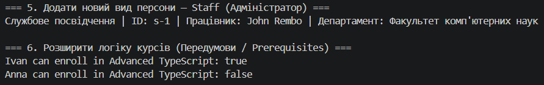
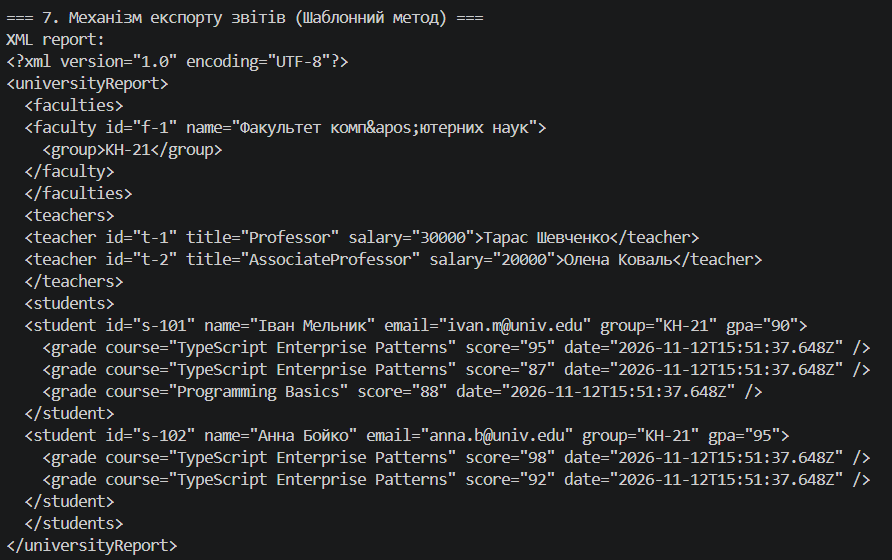
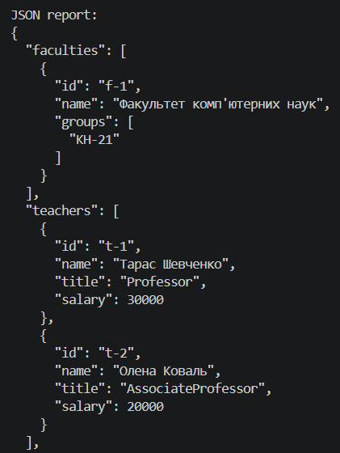
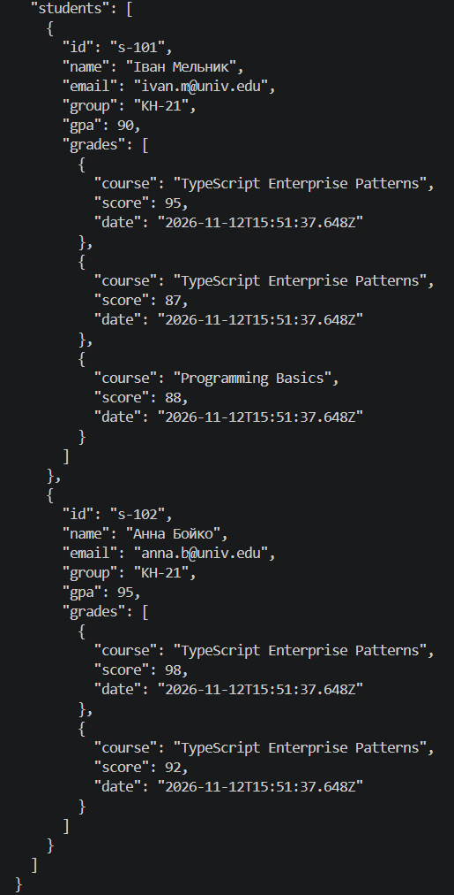
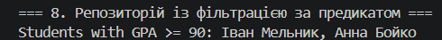

# Виконання додаткових завдань проєкту University

У цьому документі наведено результати виконання чотирьох додаткових завдань для вдосконалення проєкту.

## 1. Додавання нового виду персони — `Staff` (Адміністратор)

Створено новий тип персони `Staff`, який успадковує клас `Person`. Додано поле `department` для збереження назви департаменту та реалізовано метод генерації службового посвідчення.

**Результат виконання:**

## 2. Розширення логіки курсів — передумови (`Prerequisites`)

До курсу додано список попередніх курсів `prerequisites: Course[]`. Реалізовано перевірку, яка визначає, чи завершив студент усі необхідні курси перед записом на наступний курс.

**Результат виконання:**

На прикладі видно, що Іван може записатися на курс Advanced TypeScript, оскільки виконав передумови, а Анна — ні.

## 3. Механізм експорту звітів (Шаблонний метод)

Створено абстрактний клас `ReportGenerator`, який визначає загальний алгоритм формування звіту за допомогою методів `generateHeader()`, `generateBody()` та `generateFooter()`. Класи `XmlReportGenerator` і `JsonReportGenerator` реалізують формування звітів у відповідних форматах.

**Результат формування XML-звіту:**

**Результат формування JSON-звіту:**

## 4. Репозиторій із фільтрацією за предикатом

До інтерфейсу `IRepository<T>` додано метод `findWhere(predicate: (item: T) => boolean): Promise<T[]>`, який дає змогу отримувати записи, що відповідають заданій умові.

**Результат виконання:**

На зображенні показано результат фільтрації студентів за умовою GPA ≥ 90.

## Висновок

У межах роботи реалізовано новий тип персони `Staff`, розширено логіку запису на курси за допомогою передумов, додано механізм експорту звітів у форматах XML та JSON, а також реалізовано фільтрацію даних у репозиторії за предикатом. Наведені зображення демонструють результати виконання цих завдань.
